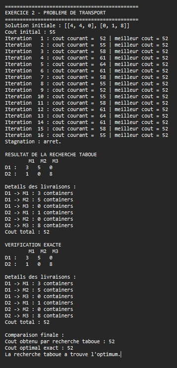
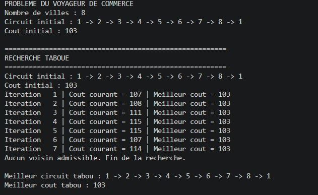
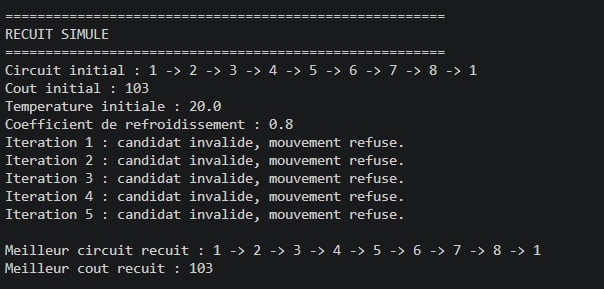
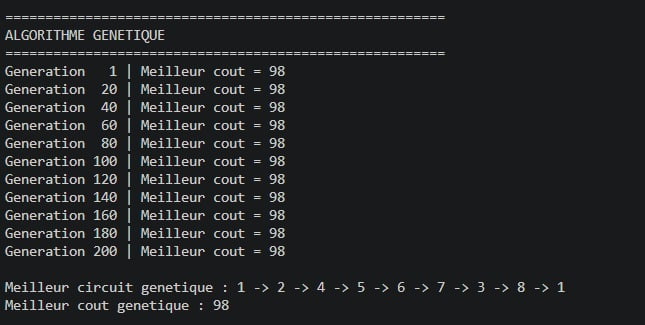
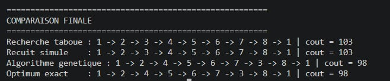

# TD : Métaheuristiques

## Introduction

Dans ce TD, nous avons travaillé sur deux problèmes d'optimisation en Python : le problème de transport et le problème du voyageur de commerce.

Le but est d'appliquer différentes méthodes pour trouver une solution avec un coût minimal.

## Exercice 2 : Problème de transport

Dans cet exercice, nous avons deux dépôts et trois magasins. Chaque dépôt possède un stock de containers et chaque magasin a une demande à satisfaire.

Nous avons utilisé la recherche taboue pour chercher une solution qui minimise le coût total du transport.

Le programme construit une solution initiale, génère des solutions voisines et garde la meilleure solution trouvée. Nous avons aussi ajouté une vérification exacte pour comparer les résultats.

### Résultat

Voir la capture d'écran de l'exécution du programme ci-dessous.

## Exercice 3 : Voyageur de commerce

Dans cet exercice, nous devons trouver un circuit qui passe par les huit villes une seule fois et revient à la ville de départ, avec le coût total le plus faible.

Nous avons appliqué trois méthodes :

- La recherche taboue.
- Le recuit simulé avec cinq itérations.
- L'algorithme génétique.

### Résultats

Les résultats obtenus sont présentés dans les captures d'écran suivantes.
**Recherche taboue**

**Recuit simulé**

**Algorithme génétique**

**Solution exacte**

## Conclusion

Ce TD nous a permis de comprendre comment utiliser plusieurs méthodes d'optimisation en Python. Nous avons remarqué que chaque méthode explore les solutions d'une manière différente. La comparaison des coûts permet de voir quelle solution est la meilleure pour les données étudiées.